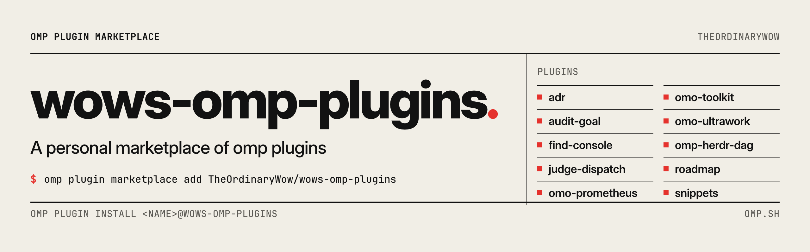

<picture>
  <source media="(prefers-color-scheme: dark)" srcset=".github/banners/root-dark.png">
  
</picture>

# wows-omp-plugins

English | [简体中文](README.zh.md)

> Plugins for [omp](https://omp.sh) that help the agent plan, carry out, review and keep track of real project work.

A personal marketplace of OMP plugins. Some add whole workflows, such as planning a change and executing it with proof, or auditing code until it stops turning up problems. Others are smaller tools for everyday use. Several are ports of workflows from [oh-my-openagent](https://github.com/code-yeongyu/oh-my-openagent) (OmO).

## Plugins

| Plugin | What it does |
| --- | --- |
| [`adr`](plugins/adr/README.md) | Keep architecture decision records in your repository; the agent drafts them and you accept them with `/adr` |
| [`audit-goal`](plugins/audit-goal/README.md) | `/audit` reviews code in rounds, fixes what it finds, and stops when no more problems turn up |
| [`find-console`](plugins/find-console/README.md) | `/find` searches code by what it does, shows scored hits and hands the useful ones to the agent |
| [`judge-dispatch`](plugins/judge-dispatch/README.md) | A judge model checks which agent should take each subagent task and how hard it is; you decide what that changes |
| [`omo-prometheus`](plugins/omo-prometheus/README.md) | Plan big changes with Prometheus, then let Atlas carry them out task by task with proof |
| [`omo-toolkit`](plugins/omo-toolkit/README.md) | Specialist agents, workflow skills and documentation search from OmO |
| [`omo-ultrawork`](plugins/omo-ultrawork/README.md) | Add `ulw` and the agent sees the request through with evidence; plus `/ulw-loop`, `/hyperplan` and `/ulw-research` |
| [`omp-herdr-dag`](plugins/omp-herdr-dag/README.md) | A live graph of todos, plans and subagents in a Herdr side pane |
| [`roadmap`](plugins/roadmap/README.md) | A project roadmap in your repository: rounds, stages with done criteria, and TODOs that every session can see |
| [`snippets`](plugins/snippets/README.md) | Saved text that expands from trigger words like `.review.` when you send, managed with `/snippets` |

Each plugin installs on its own, except that roadmap needs the adr plugin.

## Install

You need OMP 18.17.0 or newer. Add the marketplace once, then install plugins by name:

```bash
omp plugin marketplace add TheOrdinaryWow/wows-omp-plugins
omp plugin install omo-prometheus@wows-omp-plugins
```

Inside an OMP session, `/marketplace add`, `/marketplace discover` and `/marketplace install` do the same. `omp plugin discover wows-omp-plugins` lists every plugin.

Plugins install for your user. Add `--scope project` to install one only for the current project.

After installing, `/reload-plugins` loads new skills and slash commands. New tools, hooks and extensions need a session restart.

## Update

```bash
omp plugin marketplace update wows-omp-plugins
omp plugin upgrade <name>@wows-omp-plugins
```

## More details

Each plugin's README explains how to use and configure it, and its `REFERENCE.md` has the technical details, including how it behaves in RPC, ACP editors, the SDK and headless runs. Plugins with workflow state publish it as a JSON snapshot for client programs; [REFERENCE.md](REFERENCE.md) describes the format.

## Contributing

See [CONTRIBUTING.md](CONTRIBUTING.md).

## License

Code and content written for this repository are MIT unless a plugin says otherwise. The three `omo-*` plugins include modified OmO prompt assets under the Sustainable Use License 1.0; each plugin's README and license files give the details.
