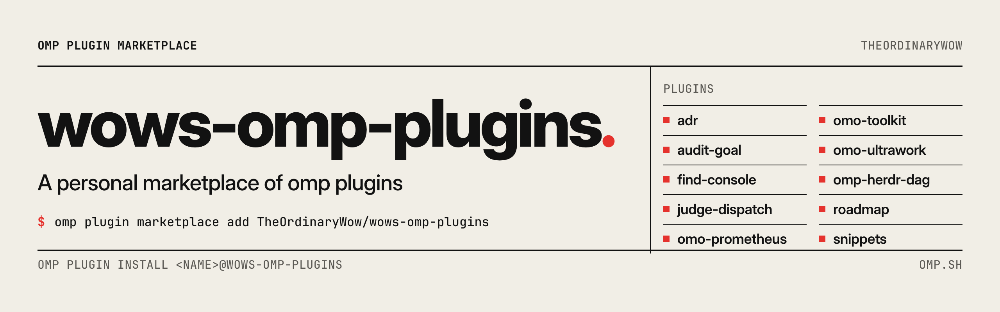

<picture>
  <source media="(prefers-color-scheme: dark)" srcset=".github/banners/root-dark.png">
  
</picture>

# wows-omp-plugins

[English](README.md) | 简体中文

> 一组 [omp](https://omp.sh) 插件，帮助代理规划、执行、审查和跟踪真实的项目工作。

这是一个个人维护的 OMP 插件市场。有的插件提供完整的工作流，比如先规划改动、再带着证据逐项执行，或者反复审计代码直到再也查不出问题；有的是日常使用的小工具。其中几个移植自 [oh-my-openagent](https://github.com/code-yeongyu/oh-my-openagent)（OmO）的工作流。

## 插件

| 插件 | 用途 |
| --- | --- |
| [`adr`](plugins/adr/README.zh.md) | 把架构决策记录保存在仓库里；代理负责起草，你用 `/adr` 决定是否接受 |
| [`audit-goal`](plugins/audit-goal/README.zh.md) | `/audit` 分轮审查代码，发现问题就修，查不出新问题时结束 |
| [`find-console`](plugins/find-console/README.zh.md) | `/find` 按代码的行为搜索，显示带分数的结果，并把有用的交给代理 |
| [`judge-dispatch`](plugins/judge-dispatch/README.zh.md) | 判定模型检查每个子代理任务该派给哪种代理、有多难，由你决定这会改变什么 |
| [`omo-prometheus`](plugins/omo-prometheus/README.zh.md) | 用 Prometheus 规划大改动，再由 Atlas 带着证据逐个任务执行 |
| [`omo-toolkit`](plugins/omo-toolkit/README.zh.md) | 来自 OmO 的专长代理、工作流技能和文档搜索 |
| [`omo-ultrawork`](plugins/omo-ultrawork/README.zh.md) | 加上 `ulw`，代理会把请求做到底并拿出证据；另有 `/ulw-loop`、`/hyperplan` 和 `/ulw-research` |
| [`omp-herdr-dag`](plugins/omp-herdr-dag/README.zh.md) | 在 Herdr 侧边窗格中实时显示待办、计划和子代理的关系图 |
| [`roadmap`](plugins/roadmap/README.zh.md) | 放在仓库里的项目路线图：轮次、带完成标准的阶段，以及每个会话都能看到的 TODO |
| [`snippets`](plugins/snippets/README.zh.md) | 保存好的文字片段，发送时由 `.review.` 这样的触发词展开，用 `/snippets` 管理 |

每个插件都可以单独安装，只是 roadmap 需要同时安装 adr 插件。

## 安装

需要 OMP 18.19.0 或更高版本。先添加一次插件市场，之后按名字安装插件：

```bash
omp plugin marketplace add TheOrdinaryWow/wows-omp-plugins
omp plugin install omo-prometheus@wows-omp-plugins
```

在 OMP 会话里，可以用 `/marketplace add`、`/marketplace discover` 和 `/marketplace install` 完成同样的操作。`omp plugin discover wows-omp-plugins` 会列出全部插件。

插件默认安装到当前用户。加上 `--scope project` 则只安装到当前项目。

安装后运行 `/reload-plugins` 可以加载新的技能和斜杠命令。新的工具、钩子和扩展要重启会话才会生效。

## 更新

```bash
omp plugin marketplace update wows-omp-plugins
omp plugin upgrade <name>@wows-omp-plugins
```

## 更多细节

每个插件的 README 说明怎么使用和配置它，它的 `REFERENCE.md` 则包含技术细节，包括在 RPC、ACP 编辑器、SDK 和无界面模式下的表现。带工作流状态的插件会把状态发布成 JSON 快照，供客户端程序读取，格式见 [REFERENCE.zh.md](REFERENCE.zh.md)。

## 参与开发

见 [CONTRIBUTING.md](CONTRIBUTING.md)。

## 许可证

除非插件另有说明，为本仓库编写的代码和内容均采用 MIT 许可证。三个 `omo-*` 插件包含经过修改的 OmO 提示词资源，适用 Sustainable Use License 1.0；详见各插件的 README 和许可证文件。
