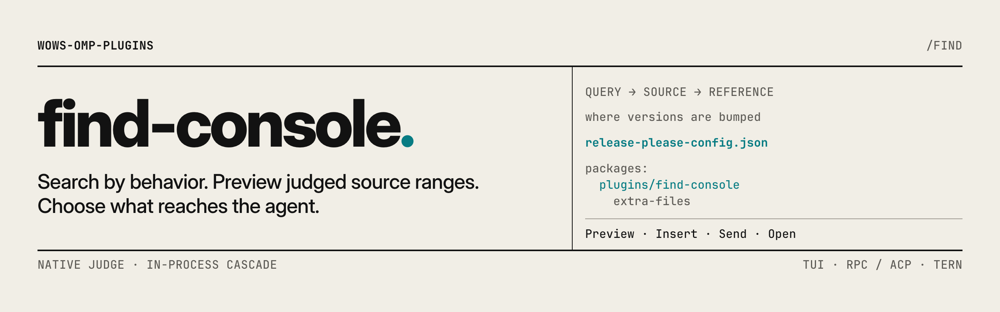

<picture>
  <source media="(prefers-color-scheme: dark)" srcset="https://raw.githubusercontent.com/TheOrdinaryWow/wows-omp-plugins/main/.github/banners/find-console-dark.png">
  
</picture>

# find-console

English | [简体中文](README.zh.md)

> Search your code by what it does, browse the scored hits, and hand the good ones to the agent.

OMP's built-in `find` tool searches code by behavior ("where are versions bumped?") instead of by exact text, but normally only the agent can run it. `/find` lets you run the same search yourself. Hits open in a console with a score for each one and a preview of the matching lines. From there you can insert a `path:start-end` reference into your message or send the hits to the agent. The agent does not take part in the search itself.

## Install

```bash
omp plugin install find-console@wows-omp-plugins
```

You need OMP 18.19.0 or newer and a judgment model behind OMP's `judge` role, such as TypeSafe's Jev. Scores come from that model, so `/find` does not run with an ordinary chat model. Start a new session after installing.

## Quick start

1. Run `/find where release-please versions are bumped`. `/find` on its own asks for the question.
2. Watch the progress view. Esc or Ctrl+C cancels the search.
3. Use Up and Down to pick a hit and Left and Right to move between its matching ranges. The preview shows the whole file with the matching lines highlighted.
4. Press Enter to insert the reference into your message, or `s` to send the hit to the agent. Esc closes the console without adding anything to the conversation.

## Usage

### Ask a question

```text
/find [--path PATH] [-k KEYWORD]... [--glob PATTERN]... [--ext EXT]... [--min-score 0.2..1] [--limit N] [--no-cache] [--no-translate] <query>
/find --help
/find --history
/find --cancel
```

Write the question as plain text; it does not need quotes. The command completes its option names.

| Option | What it does |
| --- | --- |
| `--path PATH`, `-p` | Search a directory, one file, or an OMP document such as `omp://extensions.md`, instead of the session's current directory. Quote paths with spaces. |
| `-k KEYWORD`, `--keyword` | Add a word the matching code is likely to contain. Repeat for more. |
| `--glob PATTERN` | Only search files matching the pattern. A pattern with `/` matches paths from the search root; one without matches file names anywhere. Repeat for alternatives. |
| `--ext EXT` | Only search files with this extension (`ts` or `.ts`, any case). Repeat for alternatives. Combined with `--glob`, a file must match both. |
| `--min-score` | Hide hits and ranges scored below this value, from 0.2 to 1. |
| `--limit N` | Show at most N hits. |
| `--no-cache` | Ask the judge again instead of reusing earlier answers. |
| `--no-translate` | Search with the question exactly as written (see below). |
| `--` | Everything after it is the question, even if it starts with `-`. |

```text
/find --path plugins where version manifests are updated -k release-please
/find --glob 'plugins/**/*.ts' --ext ts --min-score 0.7 --limit 5 where settings are read
/find --path omp://extensions.md how user messages are queued
```

A question written in a non-Latin script, such as Chinese or Japanese, is translated to English first, using your `tiny` model role, or `smol` if that fails. The results show `searched as: …` next to your original question. If neither model works, the search goes ahead untranslated and tells you why.

### Work with the results

Hits are ranked by score. Scores use the same strong, plausible and muted bands as the built-in `find` tool. A score is the judge's confidence that the hit answers your question, not a guarantee. A hit marked `whole-file` matched as a whole file and has no highlighted lines.

| Key | Action |
| --- | --- |
| Up, Down, Home, End | Pick a hit. A new hit opens at its strongest range. |
| Left, Right, Tab | Move between the hit's ranges, strongest first. |
| PgUp, PgDn | Scroll the preview. |
| Space | Mark or unmark a hit for sending. |
| Enter, `i` | Insert the current range's reference into your message and close. What you already typed stays. |
| `s` | Send the marked hits, or the selected one if none are marked, as your message. If the agent is busy, it is queued instead of interrupting. |
| `o` | Open the file at that line in `$VISUAL` or `$EDITOR`, or with your system's default app when no editor is set. |
| `r` | Ask a follow-up question that only searches the files in these results. |
| `h` | Pick a recent search and run it again. |
| Esc, Ctrl+C | Close without sending anything. |

By default the console fills the terminal. Set `uiMenu` to `half-screen` to keep the conversation visible above a smaller panel. In [Tern](https://docs.stencil.so/tern/), the console opens as a large native sheet with the same actions as buttons.

### Recent searches

`/find` remembers the last 50 searches in each project, with their options. Completion after `/find` offers them, and `/find --history` or `h` in the console lets you pick one and run it again. The list is stored in `.omp/.cache/find-console/history.json` in the project. It contains your questions and paths, so delete the file if you want to clear it.

### When results are incomplete

The footer reports what the search covered and what it cost:

- **Complete** means no judge request failed. It does not mean every line of every file was read; the search narrows candidates first.
- **Partial coverage** is shown above the results when some requests failed or went unanswered. A file marked partial has parts the judge did not see.
- **Unavailable** means nothing could be judged. You get an error saying so, and no results console. That is not evidence that the code you asked about does not exist.
- **No hits** shows a notice instead of an empty console. With partial coverage, the notice warns that unjudged files might still match.

The footer also shows whether answers came from the cache (`all cached`, `partly cached`, `fresh`, `cache off` or `cache unavailable`) and the cost. Answers from the cache cost nothing.

## Settings

Change a setting for your user:

```bash
omp plugin config set wows-omp-plugin-find-console uiMenu half-screen
omp plugin config list wows-omp-plugin-find-console
```

To change a setting for one project only, add it to `.omp/plugin-overrides.json` in that project:

```json
{ "settings": { "wows-omp-plugin-find-console": { "uiMenu": "half-screen" } } }
```

Changes apply the next time you run `/find`.

| Setting | Default | What it changes |
| --- | --- | --- |
| `uiMenu` | `fullscreen` | `fullscreen` fills the terminal with the results console; `half-screen` shows a smaller panel at the bottom so the conversation stays visible. Only affects the terminal. |
| `autoTranslate` | `true` | Translate non-Latin questions to English before searching. `--no-translate` turns it off for one search. |
| `previewMode` | `full-file` | `full-file` shows the whole file and scrolls to the current range; `snippet` shows only the lines around it. |

### OMP settings that affect `/find`

`/find` follows OMP's own `find.enabled` setting, for example in a project's `.omp/config.yml`:

```yaml
find:
  enabled: auto
```

| Value | Effect on `/find` |
| --- | --- |
| `auto` (OMP's default) | Runs when your `judge` role resolves to a judgment model; otherwise it explains what is missing. |
| `on` | Turns `/find` on, but it still refuses a judge that is not a judgment model and never falls back to a chat model for scores. |
| `off` | Refuses to run and says that `find.enabled` is off. |

Models and logins are set up in OMP, not in this plugin. Judge requests and translations by a remote model count toward your session's `session.maxCost` limit, the same as the built-in `find`. Once the limit is reached they are refused. Translation by a local `tiny` model costs nothing.

## Working with other plugins

find-console works on its own. It uses the same `judge` model as `judge-dispatch`, but the two do not change each other's settings.

## Known limitations

- Hits inside OMP documents and skills (`omp://`, `skill://`) can be previewed, inserted and sent, but not opened in an editor.
- `o` opens the file on the machine running OMP. An editor that only works inside a terminal needs a real terminal, and graphical editors jump to the right line only if they accept `+line`.
- The preview reads the file when you open it, up to its first 4 MiB. If the file changed after the search, the preview shows the new content.
- Cancelling a search does not refund judge requests that already ran.
- `/find` itself has no time limit. Cancel with Esc, Ctrl+C or `/find --cancel`. Switching or closing the session also cancels it.

## More details

[REFERENCE.md](REFERENCE.md) explains how hits are refined into ranges, how translation and filters work, the history file format, and how `/find` behaves in RPC, ACP editors and headless runs. OMP's own docs cover [semantic find](omp://tools/find.md) and [the judge and find settings](omp://settings.md).

## License

MIT.
