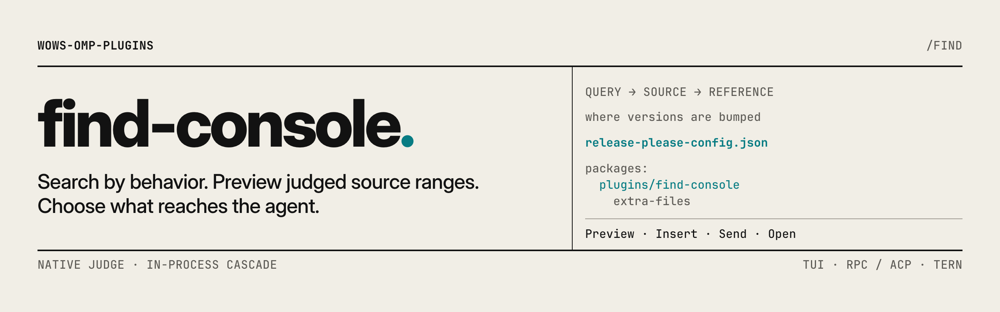

<picture>
  <source media="(prefers-color-scheme: dark)" srcset="https://raw.githubusercontent.com/TheOrdinaryWow/wows-omp-plugins/main/.github/banners/find-console-dark.png">
  
</picture>

# find-console

[English](README.md) | 简体中文

> 按“代码做了什么”来搜索，浏览带分数的结果，再把有用的交给代理。

OMP 内置的 `find` 工具按行为搜索代码（比如“版本号在哪里更新？”），不需要你知道确切的文字，但平时只有代理能用它。`/find` 让你自己来跑同样的搜索。结果会在一个控制台里打开，每条都有分数和匹配行的预览。你可以把 `path:start-end` 引用插入到消息里，也可以直接把结果发给代理。搜索过程本身不经过代理。

## 安装

```bash
omp plugin install find-console@wows-omp-plugins
```

需要 OMP 18.17.0 或更高版本，并且 OMP 的 `judge` 角色要配置一个判定模型（judgment model），比如 TypeSafe 的 Jev。分数来自这个模型，所以普通聊天模型跑不了 `/find`。安装后开一个新会话。

## 快速上手

1. 运行 `/find where release-please versions are bumped`。只输入 `/find` 会弹出输入框让你写问题。
2. 看进度界面。按 Esc 或 Ctrl+C 可以取消搜索。
3. 用上、下键选结果，用左、右键在它的几个匹配范围之间切换。预览会显示整个文件，并高亮匹配的行。
4. 按 Enter 把引用插入到你的消息里，或按 `s` 把结果发给代理。按 Esc 关闭控制台，对话里不会多出任何内容。

## 用法

### 提问

```text
/find [--path PATH] [-k KEYWORD]... [--glob PATTERN]... [--ext EXT]... [--min-score 0.2..1] [--limit N] [--no-cache] [--no-translate] <query>
/find --help
/find --history
/find --cancel
```

问题直接写成普通文字，不用加引号。命令会补全选项名。

| 选项 | 作用 |
| --- | --- |
| `--path PATH`、`-p` | 搜索某个目录、单个文件或 OMP 文档（如 `omp://extensions.md`），而不是会话的当前目录。路径含空格时要加引号。 |
| `-k KEYWORD`、`--keyword` | 补充一个匹配代码里很可能出现的词。可以重复使用。 |
| `--glob PATTERN` | 只搜索符合模式的文件。含 `/` 的模式按相对搜索根目录的路径匹配，不含 `/` 的匹配任意层级的文件名。重复使用表示“任一即可”。 |
| `--ext EXT` | 只搜索这个扩展名的文件（写 `ts` 或 `.ts` 都行，不区分大小写）。重复使用表示“任一即可”。和 `--glob` 一起用时，文件要同时满足两者。 |
| `--min-score` | 隐藏分数低于这个值的结果和范围，取值 0.2 到 1。 |
| `--limit N` | 最多显示 N 条结果。 |
| `--no-cache` | 重新询问判定模型，不复用之前的回答。 |
| `--no-translate` | 按原样搜索问题，不翻译（见下文）。 |
| `--` | 之后的内容都算作问题，即使以 `-` 开头。 |

```text
/find --path plugins where version manifests are updated -k release-please
/find --glob 'plugins/**/*.ts' --ext ts --min-score 0.7 --limit 5 where settings are read
/find --path omp://extensions.md how user messages are queued
```

用非拉丁文字（比如中文、日文）写的问题，会先用你的 `tiny` 模型角色翻译成英文，`tiny` 不行就换 `smol`。结果里会在原问题旁边显示 `searched as: …`。两个模型都用不了时，搜索会直接用原文进行，并告诉你原因。

### 查看和使用结果

结果按分数排序，分数档位和内置 `find` 工具一样分为强、可能和弱。分数表示判定模型认为这条结果回答了你的问题的把握，并不保证一定正确。标为 `whole-file` 的结果是整个文件匹配，没有高亮的行。

| 按键 | 操作 |
| --- | --- |
| 上、下、Home、End | 选择结果。新选中的结果从它分数最高的范围开始。 |
| 左、右、Tab | 在当前结果的各个范围之间切换，分数高的在前。 |
| PgUp、PgDn | 滚动预览。 |
| 空格 | 标记或取消标记要发送的结果。 |
| Enter、`i` | 把当前范围的引用插入到你的消息并关闭。已经输入的内容会保留。 |
| `s` | 把标记的结果作为你的消息发送；没有标记时发送当前选中的那条。代理正在忙时会排队，不会打断它。 |
| `o` | 用 `$VISUAL` 或 `$EDITOR` 打开文件并跳到那一行；没有设置编辑器时，用系统默认程序打开。 |
| `r` | 追问一个新问题，只在这次的结果文件里搜索。 |
| `h` | 选一条最近的搜索重新运行。 |
| Esc、Ctrl+C | 关闭，不发送任何内容。 |

控制台默认占满终端。把 `uiMenu` 设为 `half-screen` 后，会改成底部的一个较小面板，上方的对话依然可见。在 [Tern](https://docs.stencil.so/tern/) 中，控制台以大号原生面板打开，同样的操作都做成了按钮。

### 最近的搜索

`/find` 会记住每个项目最近 50 次搜索及其选项。输入 `/find` 后的补全会列出它们；`/find --history` 或控制台里的 `h` 可以选一条重新运行。记录保存在项目的 `.omp/.cache/find-console/history.json` 中，里面有你问过的问题和路径，想清空就删掉这个文件。

### 结果不完整时

底部会显示这次搜索覆盖了多少、花了多少钱：

- **Complete** 表示没有判定请求失败，并不代表每个文件的每一行都读过；搜索会先缩小候选范围。
- **Partial coverage** 表示有请求失败或没有得到回答，会显示在结果上方。标为 partial 的文件有一部分内容判定模型没有看到。
- **Unavailable** 表示什么都没能判定。你会看到一条说明错误，不会打开结果控制台。这不能说明你要找的代码不存在。
- **No hits** 会显示一条提示，而不是空的控制台。如果覆盖不完整，提示会说明没判定过的文件里仍可能有匹配。

底部还会显示回答是否来自缓存（`all cached`、`partly cached`、`fresh`、`cache off` 或 `cache unavailable`）以及费用。来自缓存的回答不收费。

## 设置

为当前用户修改设置：

```bash
omp plugin config set wows-omp-plugin-find-console uiMenu half-screen
omp plugin config list wows-omp-plugin-find-console
```

只想在某个项目里改，就在该项目的 `.omp/plugin-overrides.json` 中写上：

```json
{ "settings": { "wows-omp-plugin-find-console": { "uiMenu": "half-screen" } } }
```

修改在下次运行 `/find` 时生效。

| 设置 | 默认值 | 作用 |
| --- | --- | --- |
| `uiMenu` | `fullscreen` | `fullscreen` 让结果控制台占满终端；`half-screen` 改为底部的较小面板，对话保持可见。只影响终端。 |
| `autoTranslate` | `true` | 搜索前把非拉丁文字的问题翻译成英文。`--no-translate` 可以只在某一次搜索中关闭。 |
| `previewMode` | `full-file` | `full-file` 显示整个文件并滚动到当前范围；`snippet` 只显示当前范围附近的几行。 |

### 影响 `/find` 的 OMP 设置

`/find` 遵循 OMP 自己的 `find.enabled` 设置，例如写在项目的 `.omp/config.yml` 中：

```yaml
find:
  enabled: auto
```

| 值 | 对 `/find` 的影响 |
| --- | --- |
| `auto`（OMP 默认） | `judge` 角色是判定模型时可以运行，否则说明缺了什么。 |
| `on` | 打开 `/find`，但仍会拒绝不是判定模型的 judge，也绝不会改用聊天模型来打分。 |
| `off` | 拒绝运行，并说明 `find.enabled` 已关闭。 |

模型和登录都在 OMP 中配置，不在这个插件里。远程模型的判定请求和翻译会计入会话的 `session.maxCost` 上限，和内置 `find` 一样，到达上限后就会被拒绝。本地 `tiny` 模型的翻译不收费。

## 与其他插件配合

find-console 可以单独使用。它和 `judge-dispatch` 用的是同一个 `judge` 模型，但两者不会改动对方的设置。

## 已知限制

- OMP 文档和技能中的结果（`omp://`、`skill://`）可以预览、插入和发送，但不能在编辑器里打开。
- `o` 会在运行 OMP 的那台机器上打开文件。只能在终端里运行的编辑器需要一个真实的终端；图形编辑器只有支持 `+line` 时才能跳到正确的行。
- 预览在你打开时才读取文件，最多读前 4 MiB。如果文件在搜索后改过，预览显示的是新内容。
- 取消搜索不会退回已经发出的判定请求费用。
- `/find` 本身没有时间限制。用 Esc、Ctrl+C 或 `/find --cancel` 取消；切换或关闭会话也会取消它。

## 更多细节

[REFERENCE.zh.md](REFERENCE.zh.md) 说明了结果如何细化成范围、翻译和过滤的规则、历史文件格式，以及 `/find` 在 RPC、ACP 编辑器和无界面模式下的表现。OMP 自己的文档介绍了[语义搜索](omp://tools/find.md)以及 [judge 和 find 的设置](omp://settings.md)。

## 许可证

MIT。
