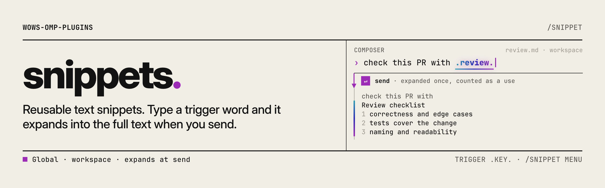

<picture>
  <source media="(prefers-color-scheme: dark)" srcset="https://raw.githubusercontent.com/TheOrdinaryWow/wows-omp-plugins/main/.github/banners/snippets-dark.png">
  
</picture>

# snippets

English | [简体中文](README.zh.md)

Save reusable blocks of text as Markdown files and expand them by typing a short trigger word, such as `.review.`, before you send. Browse, insert, send, and manage them from `/snippets`. Snippets are plain files you can edit by hand, and your personal state (pins, disabled flags, use counts) stays outside the repository.

## Install

```bash
omp plugin install wows-omp-plugins/snippets
```

Requires OMP 18.17.0 or newer. Start a new session after installing. The plugin has no runtime dependencies or credentials of its own.

## Quick start

1. Create a global snippet at `~/.omp/agent/snippets/review.md`:

   ```markdown
   ---
   description: Code review checklist
   ---
   Review checklist:
   - Does the change do what the description says?
   - Are edge cases and error paths handled?
   - Are there tests for the new behavior?
   - Are names clear and is dead code removed?
   - Does anything leak secrets or log sensitive data?
   ```

2. Start a session and type `.review.` in the editor, then send. The message the agent receives, and the one shown in your history, contains the checklist instead of the trigger word.
3. Run `/snippets` to browse every snippet, including ones that have no trigger word.

## Usage

### Where snippets live

| Scope | Location | Use it for |
|---|---|---|
| Global | `~/.omp/agent/snippets/<key>.md` | Text you reuse in every project |
| Workspace | `<project>/.omp/snippets/<key>.md` | Text that belongs to one repository |

A workspace snippet with the same key as a global one takes precedence. The global snippet stays listed, marked as shadowed, and does not expand while the workspace one exists.

The key is the file name without `.md`. Use letters, digits, `_`, or `-`, up to 64 characters. Other names are reported in `/snippets` as problems and skipped.

### File format

The frontmatter is optional. It may contain one `description` line, bare or quoted. Without frontmatter, the whole file is the body. Trailing newlines are trimmed. Files that cannot be parsed are skipped and reported. Other snippets keep working.

Hand edits are picked up the next time you send a message or open `/snippets`.

### Trigger words

By default, a snippet with key `review` expands from `.review.`:

| Setting `matching` | Trigger word for key `review` | Notes |
|---|---|---|
| `closed` (default) | `.review.` | Ends with the trigger character too |
| `open` | `.review` | Expands without the closing dot |

The default trigger is `.`. Set `trigger` to any other literal prefix. The trigger cannot contain whitespace or any of `/ ! @ ^ # : $ \` \\`. An invalid trigger shows a warning once and turns expansion off. It never falls back to `.`.

Set `trigger` to an empty string to turn off expansion and highlighting. Snippets are then used only through `/snippets`.

### When a trigger expands

Expansion happens when you send, not while you type. A trigger word is expanded only if:

- It starts and ends at word boundaries. A letter, digit, `_`, `-`, `/`, `\`, `.`, or `::` directly before it, or a `.` followed by a letter after it, stops the match. So `file.review.bak` and `x.review.` do not expand.
- It is in prose. Code spans, fenced code blocks, and HTML or XML sections are never expanded.
- The line is not a shell or Python command. Lines that start with `!` or `$` are sent exactly as typed.

To keep a trigger word literal, put a backslash in front of it: `\.review.` sends `.review.`. The backslash is removed from the sent text.

Each expansion counts one use. The sent message and the chat history show the expanded text, so the record is what the agent actually received.

### Highlighting

Trigger words glow in the editor as you type, using the host's keyword highlight. Code and shell lines are left unhighlighted, which matches what will and will not expand.

### The `/snippets` console

Run `/snippets` to open the console. It lists global and workspace snippets, sorted with pinned ones first, then by use count, then by key. The preview shows the body, the trigger word or "menu only", the scope, the file path, and whether a snippet is shadowed or disabled.

In Tern, the console is a native picker sheet. The search field and the All, Global, and Workspace tabs sit at the top, the list follows, the selected snippet's preview is below the list, and an action bar holds the actions. The terminal keeps its split view, with the list beside the preview.

The terminal keys are:

| Key | Action |
|---|---|
| Up / Down, Home / End | Select a snippet |
| PgUp / PgDn, mouse wheel | Scroll the preview |
| Tab / Shift+Tab | Cycle the All, Global, Workspace filter |
| Letters and digits | Type into the search field, which matches key, description, and body. Every word you type must match. Uppercase letters without an action also search. |
| Left / Right, Backspace, Delete | Move the caret and edit the search text, as in any text field |
| Esc | Clear the search, then close the console |
| Enter | Insert the snippet at the editor cursor. With no snippets yet, Enter creates one. Clients without an editor do not show Insert. |
| Shift+S | Send the snippet now |
| Shift+N | Create a new snippet |
| Shift+E | Edit the snippet in the form. Changing its key renames the file. |
| Shift+D | Disable or enable the snippet |
| Shift+P | Pin or unpin the snippet |
| Shift+X | Delete the snippet, after confirmation |

Uppercase S, E, D, P, X, and N act as the Shift shortcuts. Other uppercase letters search. In Tern, the action bar offers the same actions with their shortcuts.

Insert, send, and expansion each count one use.

### New and edit form

Shift+N and Shift+E open one form. It has four fields, stacked top to bottom: Key, Scope, Description, and Body. Save and Cancel sit at the bottom. The form never shows frontmatter, and it writes the file for you.

- **Key** is the file name without `.md`: letters, digits, `_`, or `-`, up to 64 characters. It is checked as you type, and a key already used in the chosen scope shows an error.
- **Scope** is Global or Workspace. Switch it with Left, Right, or Space. When you edit, the scope is shown read-only.
- **Description** is optional and takes one line.
- **Body** is the text the snippet inserts. It can span many lines.

| Key | Action |
|---|---|
| Tab / Shift+Tab | Move to the next or previous field |
| Enter | Move to the next field from Key, Scope, or Description. In Body, add a line. On Save or Cancel, press it. |
| Ctrl+S | Save |
| Esc | Cancel |

Saving with an invalid key moves the cursor to Key and shows the reason. In Tern, click a field to edit it, or click Save or Cancel.

Changing the key on an edit renames the file and keeps its pins, disabled flag, and use count.

Clients without the form (RPC and ACP) ask one dialog per field: key, then scope when creating, then description, then body. On edit, an empty key or description keeps the current value, and `-` clears the description.

### Commands

| Command | Effect |
|---|---|
| `/snippets` | Open the console. Without a UI, posts the list and any problems as a message. |
| `/snippets <key>` | Insert the snippet into the editor. Needs a client with an editor; otherwise it shows an error pointing to `/snippets send <key>`. |
| `/snippets send <key>` | Send the snippet as a user message. |
| `/snippets list` | Post the list as a message. |

Command forms resolve only enabled, non-shadowed snippets. The words `send` and `list` take precedence over snippets with those keys, so rename such a snippet.

### Personal state

Pins, disabled flags, and use counts live in `~/.omp/agent/wows-omp-plugins/snippets/state.json`, not in your project. The file is outside the repository, so it never shows up in commits.

## Settings

Set these in the plugin settings, either globally or per project. They are read on every use.

| Setting | Values | Default | Effect |
|---|---|---|---|
| `trigger` | Literal string, or empty | `.` | The prefix that starts a trigger word. Empty turns off expansion and highlighting. |
| `matching` | `closed`, `open` | `closed` | Whether the trigger ends with a second `.` (`.review.`) or not (`.review`). |

To use `?` instead of `.` with the open form, set `trigger` to `?` and `matching` to `open`. With these settings, `?review` expands.

## Working with other plugins

No other marketplace plugin is required. The plugin does not register a `tool_call` or `tool_result` hook, so it does not disable speculative reads or launches.

## Without the terminal UI

| Host | Behavior |
|---|---|
| Terminal TUI | Full console, with highlights in the editor. |
| Tern | Expansion works. The console is a native picker sheet, and New and Edit open a native form. |
| RPC and ACP | Expansion works. `/snippets` uses selector dialogs for the list and actions; New and Edit ask one dialog per field. |

Without a UI, `/snippets` posts the list and problems as a message. Expansion still works.

## Known limitations

- Expansion happens only at send. There is no in-place expansion while you type, so a trigger word stays as typed until you send.
- The highlight glow uses an internal host module. A future omp release could change it and stop the glow, without affecting expansion.
- Inserting a long snippet from the menu in the terminal TUI can collapse the text into a paste marker. Send it with `/snippets send` or check the text before sending.

## Reference

The [implementation reference](REFERENCE.md) documents the file grammar, matching boundaries, escape rule, settings schema, state file schema, and input event behavior.

## License

MIT.
