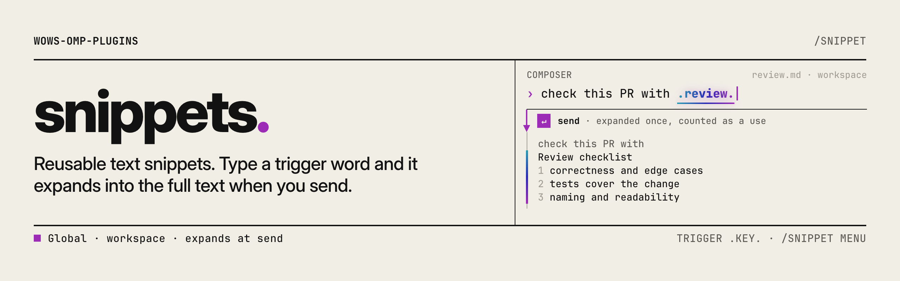

<picture>
  <source media="(prefers-color-scheme: dark)" srcset="https://raw.githubusercontent.com/TheOrdinaryWow/wows-omp-plugins/main/.github/banners/snippets-dark.png">
  
</picture>

# snippets

[English](README.md) | 简体中文

把常用文本保存为 Markdown 文件，发送前输入一个简短的触发词（例如 `.review.`）即可展开。通过 `/snippet` 浏览、插入、发送和管理片段。片段就是普通文件，可以直接手动编辑；个人状态（置顶、停用标记、使用次数）保存在仓库之外。

## 安装

```bash
omp plugin install wows-omp-plugins/snippets
```

需要 OMP 18.12.0 或更高版本。安装后启动新会话。插件没有运行时依赖，也不单独保存凭据。

## 快速开始

1. 在 `~/.omp/agent/snippets/review.md` 创建一个全局片段：

   ```markdown
   ---
   description: 代码审查清单
   ---
   代码审查清单：
   - 改动是否符合描述的目标？
   - 边界情况和错误路径是否处理？
   - 新行为是否有测试？
   - 命名是否清楚，是否删除了无用代码？
   - 是否泄露密钥或记录了敏感数据？
   ```

2. 启动会话，在编辑器中输入 `.review.` 后发送。代理收到的消息，以及历史记录中显示的内容，都是清单，而不是触发词。
3. 运行 `/snippet` 浏览所有片段，包括没有触发词的片段。

## 用法

### 片段的位置

| 范围 | 位置 | 适用场景 |
|---|---|---|
| 全局 | `~/.omp/agent/snippets/<key>.md` | 在所有项目中复用的文本 |
| 工作区 | `<项目>/.omp/snippets/<key>.md` | 只属于某个仓库的文本 |

工作区片段与全局片段的 key 相同时，工作区片段优先。全局片段仍会列出，并标记为已覆盖，只要工作区片段存在，它就不会展开。

key 是去掉 `.md` 的文件名，使用字母、数字、`_` 或 `-`，最长 64 个字符。其他名称会在 `/snippet` 中作为问题显示，并被跳过。

### 文件格式

frontmatter 可选，其中可以包含一行 `description`，可以是裸文本或双引号字符串。没有 frontmatter 时，整个文件都是正文。正文末尾的换行会被去掉。无法解析的文件会被跳过并报告，其他片段不受影响。

手动编辑的内容会在你下次发送消息或打开 `/snippet` 时生效。

### 触发词

默认情况下，key 为 `review` 的片段由 `.review.` 展开：

| 设置 `matching` | key 为 `review` 时的触发词 | 说明 |
|---|---|---|
| `closed`（默认） | `.review.` | 结尾也有触发字符 |
| `open` | `.review` | 不带结尾的点 |

默认触发前缀是 `.`。可以把 `trigger` 设为其他字面前缀。触发前缀不能包含空白字符，也不能包含 `/ ! @ ^ # : $ \` \\` 中的任何字符。无效的触发前缀会警告一次并关闭展开，绝不会回退到 `.`。

把 `trigger` 设为空字符串可以关闭展开和高亮，片段只能通过 `/snippet` 使用。

### 何时展开

展开发生在发送时，而不是输入时。只有满足以下条件的触发词才会展开：

- 它位于词的边界上。前面紧邻字母、数字、`_`、`-`、`/`、`\`、`.` 或 `::` 会阻止匹配；后面紧跟 `.` 加字母也会阻止匹配。因此 `file.review.bak` 和 `x.review.` 不会展开。
- 它位于正文中。行内代码、围栏代码块以及 HTML 或 XML 片段中的内容从不展开。
- 所在行不是 shell 或 Python 命令。以 `!` 或 `$` 开头的行会原样发送。

如果想保留字面的触发词，在它前面加反斜杠：`\.review.` 发送的是 `.review.`，反斜杠会被去掉。

每次展开记一次使用。发送的消息和聊天历史都显示展开后的文本，记录的内容就是代理实际收到的内容。

### 高亮

输入时，触发词会在编辑器中以宿主的关键词高亮方式发光。代码和 shell 行不会高亮，与实际展开的范围保持一致。

### `/snippet` 控制台

运行 `/snippet` 打开控制台。它列出全局和工作区片段，排序规则是置顶优先，其次按使用次数，最后按 key。预览区显示正文、触发词或“仅菜单”、范围、文件路径，以及片段是否已覆盖或停用。

| 按键 | 操作 |
|---|---|
| 上 / 下，Home / End | 选择片段 |
| PgUp / PgDn，鼠标滚轮 | 滚动预览 |
| Tab / Shift+Tab | 循环切换 All、Global、Workspace 过滤 |
| 字母和数字 | 按 key、描述和正文搜索。没有对应动作的大写字母也参与搜索。 |
| Backspace | 编辑搜索文本 |
| Esc | 先清空搜索，再关闭控制台 |
| Enter | 在编辑器光标处插入片段。没有编辑器的客户端不显示插入。 |
| Shift+S | 立即发送片段 |
| Shift+N | 新建片段 |
| Shift+E | 编辑选中片段的正文，然后可选择改 key（Esc 或留空则保留原 key） |
| Shift+D | 停用或启用片段 |
| Shift+P | 置顶或取消置顶 |
| Shift+X | 删除片段，需确认 |

大写 S、E、D、P、X、N 作为 Shift 快捷键使用，其他大写字母用于搜索。

插入、发送和展开各记一次使用。

### 命令

| 命令 | 作用 |
|---|---|
| `/snippet` | 打开控制台。没有 UI 时，将列表和所有问题作为消息发布。 |
| `/snippet <key>` | 把片段插入编辑器。需要带编辑器的客户端；否则显示错误，并提示使用 `/snippet send <key>`。 |
| `/snippet send <key>` | 把片段作为用户消息发送。 |
| `/snippet list` | 把列表作为消息发布。 |

命令只解析已启用且未被覆盖的片段。`send` 和 `list` 两个子命令的优先级高于同名片段，因此同名片段需要改名。

### 个人状态

置顶、停用标记和使用次数保存在 `~/.omp/agent/wows-omp-plugins/snippets/state.json`，不在项目中。该文件位于仓库之外，不会进入提交。

## 设置

在插件设置中配置，可以全局设置，也可以按项目设置。每次使用时都会重新读取。

| 设置 | 可选值 | 默认值 | 作用 |
|---|---|---|---|
| `trigger` | 字面字符串，或空字符串 | `.` | 触发词的前缀。为空时关闭展开和高亮。 |
| `matching` | `closed`、`open` | `closed` | 触发词结尾是否带第二个 `.`（`.review.`），还是不带（`.review`）。 |

要把 `.` 换成 `?` 并使用 open 形式，把 `trigger` 设为 `?`，`matching` 设为 `open`。这样设置后，`?review` 会展开。

## 与其他插件配合

不依赖其他市场插件。插件不注册 `tool_call` 或 `tool_result` 钩子，因此不会关闭推测式读取或启动。

## 没有终端界面时

| 宿主 | 行为 |
|---|---|
| 终端 TUI | 完整控制台，编辑器中有高亮。 |
| Tern | 展开可用；控制台遵循宿主的原生对话框。 |
| RPC 和 ACP | 展开可用；`/snippet` 使用选择器和编辑器对话框。 |

没有 UI 时，`/snippet` 将列表和问题作为消息发布。展开仍然可用。

## 已知限制

- 展开只发生在发送时。输入过程中不会就地展开，触发词在发送前保持原样。
- 高亮发光依赖宿主的内部模块。未来的 omp 版本可能改变它，导致发光失效，但不影响展开。
- 在终端 TUI 中从菜单插入较长的片段时，文本可能折叠成粘贴标记。可以改用 `/snippet send`，或在发送前检查文本。

## 参考

[实现参考](REFERENCE.zh.md)说明了文件语法、匹配边界、转义规则、设置结构、状态文件结构以及输入事件行为。

## 许可证

MIT。
