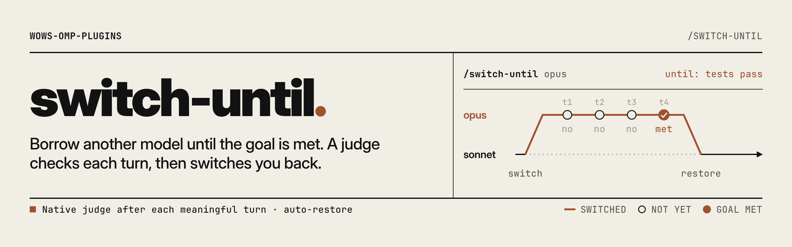

<picture>
  <source media="(prefers-color-scheme: dark)" srcset="https://raw.githubusercontent.com/TheOrdinaryWow/wows-omp-plugins/main/.github/banners/switch-until-dark.png">
  
</picture>

# switch-until

English | [简体中文](README.zh.md)

> Switch the session to another model until a goal is met, then switch back on its own.

Say you want a stronger model for one stretch of a session and your usual model for the rest. Without help, you have to keep watching the session to know when to switch back. `/switch-until` does the watching. You pick a model and state a goal once, and the session switches right away. After each reply, OMP's judge model checks whether the goal is met. When it is, the plugin switches back to the model and thinking level you had before.

While the switch is on, the stronger model makes the main session's decisions. For example, it writes the fix prompts that subagents receive, and the session returns to a cheaper model afterward. A careful model for a risky step and your default for everything else works the same way.

Only the main session's model changes. Subagents keep the models they already have.

## Install

```bash
omp plugin install switch-until@wows-omp-plugins
```

You need OMP 19.2.0 or newer and a judgment model behind OMP's `judge` role. The judge decides whether the goal is met, so `/switch-until` refuses to start unless the judge can run for the model you pick. It never falls back to a chat model.

## Quick start

1. Run `/switch-until`. A model picker opens. Choose the model to switch to.
2. Type the goal at "Until what?", for example `the migration tests pass`. The goal must fit on one line.
3. Type extra guidance at "Additional context (optional)", or submit an empty box to skip it.
4. The session switches. The status line shows `until:` followed by your goal.
5. When the judge finds the goal met, the plugin switches back and posts a notice that names the model it restored.

## Usage

### Start a switch

`/switch-until` asks three things in order: the model, the goal, and optional context. Cancel any step and the session stays as it was.

To skip the picker, name the model after the command:

```text
/switch-until provider/id:high
```

The name works like a model name elsewhere in OMP: a full `provider/id`, or a shorter part of an id that matches one model. A `:level` suffix sets the thinking level. Pressing Tab after `/switch-until` lists model names, `status` and `cancel`.

If the conversation is longer than the context window of the model you switch to, OMP compacts it first, the same as `/switch`. The plugin compacts the same way before it switches back. If compaction fails, or the conversation still does not fit afterward, the plugin does not switch and shows an error.

### Let the judge decide

The judge runs after a turn that ends with text, and after a turn in which a subagent task finished. Turns that only call tools are skipped. The judge reads your goal, the latest messages in the session, and the state other plugins publish for the session. It returns the probability that the goal is met. The plugin switches back once that probability reaches `minimumConfidence`, which is 0.8 by default.

The plugin switches back only on a judgment made from the latest messages. If new messages arrive while the judge is still working, the plugin judges them next. An older answer never switches the model back by itself.

The judge is a model, so it can switch back a little early or a little late. `/switch-until status` shows the latest judgment.

### Check or stop a switch

- `/switch-until status` shows the temporary model, the model to restore, the goal, whether extra context is set, the elapsed time, the number of judged turns, and the last judgment with its probability and time. After a switch has ended, it shows how the switch ended, along with the goal and the last judgment.
- `/switch-until cancel` switches back to your original model right away.

### Replace a switch

Running `/switch-until` while a switch is active asks whether to replace it. The new goal, context and model take the place of the old ones. The model and thinking level you had before the first switch are still the ones restored at the end.

### When a switch ends

A switch ends in one of four ways:

- The goal is met. The model switches back to the model and thinking level you had, on the same provider route.
- You run `/switch-until cancel`. The model switches back.
- A turn or time limit is reached. The model switches back, and the notice says which limit. Requests to the temporary model wait until the switch back finishes. If the switch back fails, those requests are stopped. This applies even if the notice is late or a cancel fails.
- The session model changes some other way, such as with `/switch`. The plugin stops and leaves the model you chose in place. Automatic fallbacks, which OMP uses to retry on a backup model when one fails, do not end the switch. Picking the target model yourself after a fallback also ends the switch, and nothing is restored.

If switching back fails, the plugin shows an error and tries again every minute.

If you resume a session, an unfinished switch resumes with it, along with the translations it had saved. The plugin sets the target model and thinking level again. If you changed the model yourself while the session was closed, the switch ends as described above, without restoring. A reply that came in while the session was closed is judged right away.

## Settings

Change a setting for your user:

```bash
omp plugin config set wows-omp-plugin-switch-until maxHours 8
omp plugin config list wows-omp-plugin-switch-until
```

To change a setting for one project only, add it to `.omp/plugin-overrides.json` in that project:

```json
{ "settings": { "wows-omp-plugin-switch-until": { "maxHours": 8 } } }
```

The plugin reads settings at the start and end of each turn, during setup, and at each check of the time limit. A change applies from the next check.

| Setting | Default | What it changes |
| --- | --- | --- |
| `minimumConfidence` | `0.8` | How sure the judge must be, from `0.5` to `1`, before the model switches back. A higher value waits longer. A lower value switches back sooner, on weaker evidence. |
| `maxTurns` | `0` | Switch back after this many turns since the switch started. Every finished turn counts, including turns the judge skips. `0` means no limit. |
| `maxHours` | `6` | Switch back after this many hours. Fractions work, such as `0.5`. |
| `contextMessages` | `6` | How many of the latest session messages the judge reads each time. More messages give the judge more evidence, and each judgment costs more. |

An invalid value produces a warning and the default is used.

## Working with other plugins

switch-until works on its own. It uses the same `judge` model as find-console and judge-dispatch, and none of the three changes another's settings. switch-until reads the state other plugins publish for the session, so their results can count as evidence. It never changes that state. Subagent models, including the ones judge-dispatch sets, are left alone.

## Known limitations

- Only the main session's model changes. Work that subagents do keeps the models they already have.
- The judge reads English. A goal or message in another language is translated first, using the model OMP assigns to your `tiny` role, or your `smol` role if that fails. If the goal cannot be translated when you set it, the command stops with an error. During a switch, if a message cannot be translated, that judgment is skipped with a warning, and the next qualifying turn tries again. Translations are saved in the session, so resuming does not translate them again.
- Only one switch can be active in a session at a time.
- Each judgment is a model call. Remote judge and translation calls count toward `session.maxCost`, the same as for `/find`.
- If the original model is no longer available, or compaction fails before the switch back, the plugin cannot switch back. It shows an error and tries again every minute.
- The size check reads the conversation the way the current model sees it. If the provider compacted the conversation itself, a switch to a model with a much smaller window on another provider can still overflow that window.
- If a turn limit is reached just as the model pauses without calling a tool, and the switch back needs compaction first, the session stops there. Send a message to continue.
- The judge can be wrong. Check the result when it matters.

## More details

[REFERENCE.md](REFERENCE.md) covers how the judge reads the session, how translation and plugin state are used, how the switch and the restore work, the saved entry format, and how the plugin behaves in RPC, ACP and headless runs. OMP's own docs cover [the judge and find settings](omp://settings.md).

## License

MIT.
