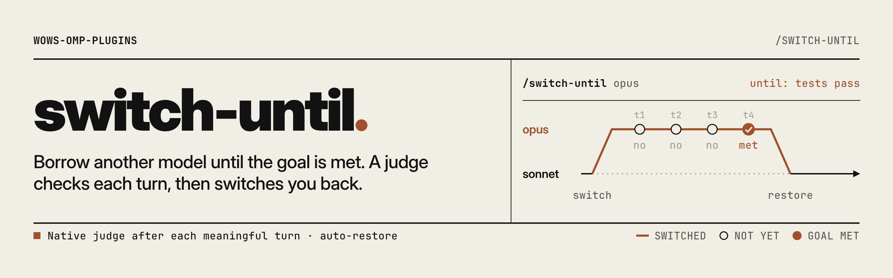

<picture>
  <source media="(prefers-color-scheme: dark)" srcset="https://raw.githubusercontent.com/TheOrdinaryWow/wows-omp-plugins/main/.github/banners/switch-until-dark.png">
  
</picture>

# switch-until

[English](README.md) | 简体中文

> 把会话切到另一个模型，直到目标达成，然后自动切回来。

有时候你只想让会话的一段用更强的模型，其余时间还用平时的模型。手动做的话，得一直盯着会话，才知道什么时候切回去。`/switch-until` 替你盯着。你选好模型、说一次目标，会话马上切换。每次回复结束后，OMP 的判定模型（judge）会检查目标是否达成。达成了，插件就切回你之前用的模型和思考档位。

切换期间，主会话的决定由更强的模型来做。比如它来写派给子代理的修复提示，事情做完后，会话再回到便宜的模型。风险高的一步用更仔细的模型，其余时间用默认模型，也是同样的道理。

只有主会话的模型会变。子代理保持它们原来的模型。

## 安装

```bash
omp plugin install switch-until@wows-omp-plugins
```

需要 OMP 19.2.0 或更高版本，并且 OMP 的 `judge` 角色要配置一个判定模型。判定模型负责判断目标是否达成。`/switch-until` 会先确认判定模型能用于你选的模型，条件不满足就拒绝启动，不会改用聊天模型。

## 快速上手

1. 运行 `/switch-until`，打开模型选择器，选好要切换到的模型。
2. 在 "Until what?" 里输入目标，比如 `迁移测试全部通过`。目标要写在一行内。
3. 在 "Additional context (optional)" 里输入补充说明。不需要的话直接提交空内容。
4. 会话切换完成。状态栏会显示 `until:` 加上你的目标。
5. 判定模型认定目标达成后，插件会切回原来的模型，并发出一条通知，说明恢复到了哪个模型。

## 用法

### 开始切换

`/switch-until` 依次询问三件事：模型、目标、可选的补充说明。任何一步取消，会话都保持原样。

想跳过选择器，就在命令后面直接写模型：

```text
/switch-until provider/id:high
```

写法和 OMP 里其他地方的模型名一样，可以是完整的 `provider/id`，也可以是能唯一匹配某个模型的 id 片段。`:level` 后缀设置思考档位。在 `/switch-until` 后按 Tab，会列出模型名、`status` 和 `cancel`。

如果当前对话比目标模型的上下文窗口还长，OMP 会先压缩对话，和 `/switch` 的做法一样。切回原模型前，插件也会同样压缩。压缩失败，或者压缩后对话仍然放不下，插件就不切换，并显示错误。

### 让判定模型来判断

在一轮以文字结束的回复之后，以及子代理任务完成的那一轮之后，判定模型会检查一次。只调用工具、没有文字的轮次会跳过。判定模型读取你的目标、会话里最近的消息，以及其他插件为本会话发布的状态，然后给出目标已达成的概率。概率达到 `minimumConfidence`（默认 0.8）时，插件就切回去。

插件只根据最新消息做出的判定来切回。判定还在进行时如果又有新消息，插件接着判定那些新消息。旧的判定结果不会自己把模型切回去。

判定模型毕竟是模型，可能早一点或晚一点切回。`/switch-until status` 可以看最近一次判定的结果。

### 查看或停止切换

- `/switch-until status` 显示临时使用的模型、要恢复的模型、目标、是否设置了补充说明、已经过去的时间、已判定的轮数，以及最近一次判定的概率和时间。切换结束后，它会显示结束的原因、目标和最近一次判定。
- `/switch-until cancel` 立刻切回原来的模型。

### 替换正在进行的切换

切换进行中再运行 `/switch-until`，会先问你要不要替换。新的目标、补充说明和模型会取代旧的。最后恢复的仍是第一次切换前的模型和思考档位。

### 切换结束的几种情况

切换会以下面四种方式结束：

- 目标达成，切回原来的模型和思考档位，并且走原来的服务商路由。
- 运行 `/switch-until cancel`，切回原模型。
- 达到轮数或时间上限，切回原模型，通知里会说明是哪个上限。切回完成之前，发往临时模型的请求会一直等着。如果切回失败，这些请求会被停止。即使通知晚到，或者取消失败，这一限制也照常生效。
- 会话模型被其他方式改了，比如用 `/switch`。插件会停下来，保留你当前选的模型。OMP 在模型出错时会改用备用模型重试，这种自动切换不会结束切换。自动切到备用模型之后，你自己再选回目标模型，同样会结束切换，并且不做恢复。

切回失败时，插件会报错，并每分钟重试一次。

恢复会话时，还没结束的切换会一起恢复，已经保存的翻译也一起恢复。插件会重新设置目标模型和思考档位。如果关闭期间你手动换过模型，切换会按上文的说明结束，不做恢复。关闭期间新增的回复，判定模型会立刻检查。

## 设置

为当前用户修改设置：

```bash
omp plugin config set wows-omp-plugin-switch-until maxHours 8
omp plugin config list wows-omp-plugin-switch-until
```

只想在某个项目里修改，就在该项目的 `.omp/plugin-overrides.json` 中写上：

```json
{ "settings": { "wows-omp-plugin-switch-until": { "maxHours": 8 } } }
```

插件会在每一轮开始和结束时、设置阶段以及每次检查时间上限时读取设置，所以修改会从下一次检查起生效。

| 设置 | 默认值 | 作用 |
| --- | --- | --- |
| `minimumConfidence` | `0.8` | 判定模型要有多大把握（`0.5` 到 `1`）才切回。值越高越保守，等得越久。值越低，证据稍弱也会切回，切回得更早。 |
| `maxTurns` | `0` | 切换开始后，过了这么多轮就切回。每一轮结束都会计数，包括判定模型跳过的那些轮。`0` 表示不限。 |
| `maxHours` | `6` | 过了这么多小时就切回。可以写小数，比如 `0.5`。 |
| `contextMessages` | `6` | 每次判定时，判定模型读取会话里最近多少条消息。读的越多，证据越充分，但每次判定的花费也越高。 |

设置值无效时会给出警告，并使用默认值。

## 与其他插件配合

switch-until 可以单独使用。它和 find-console、judge-dispatch 用的是同一个 `judge` 模型，三者也不会改动彼此的设置。switch-until 会读取其他插件为本会话发布的状态，把它们当作判断依据，但从不修改这些状态。子代理的模型，包括 judge-dispatch 设置的那些，都不受影响。

## 已知限制

- 只有主会话的模型会变。子代理的工作仍使用它们原来的模型。
- 判定模型读取的是英文。目标或消息如果是其他语言，会先翻译：优先用 `tiny` 模型角色对应的模型，失败了再用 `smol`。设置目标时翻译失败，命令会报错并停止。切换过程中，如果某条消息翻译不了，这次判定会跳过并显示警告，下一个符合条件的轮次会再试一次。翻译结果保存在会话里，恢复时不会重新翻译。
- 同一个会话里同一时间只能有一个切换。
- 每次判定都是一次模型调用。远程判定模型和翻译的调用费用会计入 `session.maxCost`，和 `/find` 一样。
- 如果原模型已经不可用，或者切回前压缩失败，插件就切不回去。它会报错，并每隔一分钟重试一次。
- 大小检查按当前模型的视角计算会话大小。如果服务商自己压缩过对话，之后切到另一家服务商、窗口小得多的模型，对话仍可能超出那个窗口。
- 如果上限恰好在模型一轮没有调用工具就停下来的时候触发，而切回前又需要压缩，会话会停在那里。发一条消息就能继续。
- 判定模型也可能判断错。结果关系重大时，请自己核对一下。

## 更多细节

[REFERENCE.zh.md](REFERENCE.zh.md) 说明了判定模型如何读取会话、翻译和插件状态如何使用、切换与恢复的过程、保存的记录格式，以及插件在 RPC、ACP 和无界面运行中的表现。OMP 自己的文档介绍了 [judge 和 find 的设置](omp://settings.md)。

## 许可证

MIT。
